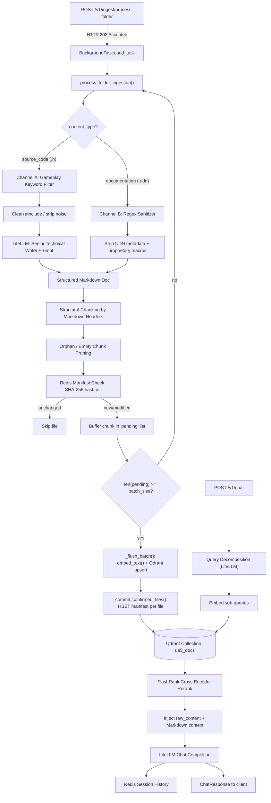

English | [Português (BR)](./README.pt-BR.md)
 
---
 
# Unreal Code-to-Doc Pipeline
 
### High-Performance Asynchronous ETL Engine for Distilling Unreal Engine 5 Source Code into Semantic RAG Documentation
 


 
---
 
## Overview
 
The Unreal Engine 5 source tree is enormous, deeply nested, and written for a compiler — not for a language model. Feeding raw `.h` headers or vendor `.udn` documentation files directly into a vector database produces a corpus polluted with `#include` noise, access-modifier boilerplate, proprietary markup macros, and orphaned fragments. The result is a Retrieval-Augmented Generation (RAG) system that retrieves syntactically similar but semantically useless chunks, and a downstream LLM that either hallucinates or contradicts itself.
 
This repository implements a **Code-to-Doc ETL pipeline**: an asynchronous FastAPI service that walks a mounted Unreal Engine source directory, applies aggressive structural filtering, transforms raw C++ headers into gameplay-oriented Markdown documentation via an LLM, sanitizes official `.udn` documentation through pure regex (no LLM call), and indexes the resulting chunks into **Qdrant** with a **Redis**-backed idempotency manifest.
 
The system was purpose-built to feed a downstream RAG assistant (`POST /v1/chat`) capable of answering precise UE5 gameplay-programming questions — grounded in real engine symbols, not generic web knowledge.
 
---
 
## Key Features
 
- **Dual-Channel Ingestion Engine** — `content_type: source_code` routes `.h` files through **Channel A** (LLM-based technical writer); `content_type: documentation` routes `.udn` files through **Channel B** (pure regex sanitization, zero LLM cost).
- **Redis-Backed Idempotency Manifest** — every source file's identity is tracked as a SHA-256 hash in a Redis Hash (`manifest:{collection_name}`), keyed by relative path. Unchanged files are skipped entirely on re-ingestion; modified files trigger orphan-chunk cleanup in Qdrant before re-indexing.
- **Atomic Commit Boundary (`_PendingFileCommit`)** — chunks are buffered across files and flushed to Qdrant in batches for network efficiency, but the manifest is **never** updated from in-memory chunk counts. Each file is tracked individually (`total_chunks` vs. `confirmed_chunks`); only when every chunk of a file has been successfully upserted is its hash committed. A crash mid-batch leaves no false checkpoint — the file is simply reprocessed from scratch on the next run.
- **Aggressive Structural Filtering at the Source** — directories such as `Private`, `ThirdParty`, `Intermediate`, `Binaries`, `Saved`, and `.git` are excluded from the walk (`_IGNORED_DIR_NAMES`); Channel A further restricts itself to headers containing gameplay-relevant symbols (`_GAMEPLAY_KEYWORDS`: `Character`, `Pawn`, `Actor`, `Component`, `GameMode`, `PlayerController`, `Subsystem`, etc.).
- **Orphan/Empty Chunk Pruning** — after structural Markdown chunking, any chunk reduced to a single orphaned header line (e.g. a truncated `#` heading with no body) is dropped before it ever reaches the embedding stage, directly saving on embedding-API tokens.
- **Consecutive-Failure Quarantine** — a file that fails `INGESTION_MAX_CONSECUTIVE_FAILURES` times in a row (default: 3) is automatically quarantined and skipped on subsequent runs, preventing wasted LLM/embedding calls on a permanently broken file until manual intervention.
- **Distributed Redis Lock per Collection** — `ingestion_lock_key` serializes concurrent executions of `process_folder_ingestion` against the same Qdrant collection, with a self-expiring TTL (`INGESTION_LOCK_TIMEOUT_SECONDS`, default 3600s) as a safety net against orphaned locks from crashed processes.
- **Hybrid RAG Payload Enrichment** — the embedding vector is always generated from the LLM-synthesized Markdown (`chunk["text"]`), but the Qdrant payload additionally stores `raw_content` — the original, untouched source (cleaned C++ header or sanitized `.udn`) — which `rag_service.py` later injects as a sovereign "Direct Reference" source for exact syntax (signatures, `UPROPERTY`/`UFUNCTION` macros) alongside the conceptual summary.
- **Non-Blocking Ingestion via BackgroundTasks** — `POST /v1/ingest/process-folder` performs only a cheap synchronous `Path.is_dir()` check and returns **HTTP 202 Accepted** immediately; the full filesystem walk, LLM calls, embedding generation, and Qdrant upserts run afterward via FastAPI's `BackgroundTasks`, dispatched through `asyncio.to_thread()` for blocking I/O so the same event loop serving `/v1/chat` is never starved.
- **Resilient Embedding Calls** — `embed_text()` wraps every LiteLLM `/embeddings` call in a `tenacity`-based retry with exponential backoff and jitter (`litellm_max_retries`, default 4), tolerant of HTTP 429/500/502/503/504 and timeouts — critical when a single ingestion run can trigger tens of thousands of embedding calls.
- **Advanced RAG Reranking** — the chat pipeline layers a CPU-only **FlashRank** cross-encoder (`ms-marco-MiniLM-L-12-v2`) on top of vector search to improve retrieval precision without any GPU dependency.
---
 
## Architecture and Data Flow
 

 
**Narrative flow:**
 
1. A client calls `POST /v1/ingest/process-folder` with a `folder_path` (absolute, **inside** the `ue5-agent` container) and a `content_type`. The endpoint validates the directory exists and immediately returns `IngestAcceptedResponse` (HTTP 202).
2. `process_folder_ingestion()` acquires a Redis distributed lock (`ingestion_lock_key`) scoped to the Qdrant collection, loads the manifest and failures caches, then recursively discovers all `.h` or `.udn` files (`_discover_files`), skipping ignored directories.
3. Each file's SHA-256 hash is compared against the Redis manifest. Unchanged files are skipped; modified or new files trigger deletion of any existing orphaned chunks in Qdrant (`_delete_file_chunks`) before regeneration.
4. **Channel A** (`source_code`) applies the gameplay-keyword filter, strips `#include` statements and excess blank lines, truncates oversized headers (`ingestion_max_header_chars`), and calls the LLM configured in `INGESTION_DOCUMENTER_MODEL` with the `_DOCUMENTER_SYSTEM_PROMPT` — a "Senior Technical Documentation Writer at Epic Games" persona producing structured Markdown.
5. **Channel B** (`documentation`) strips `.udn` metadata fields (`Availability`, `Title`, `Crumbs`, etc.) and proprietary bracket macros via regex only — no LLM invocation, no token cost.
6. Both channels converge into structural Markdown-header chunking, followed by the orphan/empty-chunk pruning pass.
7. Chunks accumulate in a shared `pending` buffer; once `ingestion_batch_size` is reached, `_flush_batch()` generates embeddings concurrently (bounded by `ingestion_embedding_concurrency`) and performs an atomic upsert into Qdrant.
8. Only after a file's chunks are **all** confirmed upserted does `_commit_confirmed_files()` write its hash into the Redis manifest — guaranteeing the checkpoint never lies about partial progress.
9. On the retrieval side, `POST /v1/chat` decomposes the user's question into technical-English sub-queries, embeds them, retrieves candidates from Qdrant, reranks with FlashRank, injects both the synthesized Markdown and the `raw_content` payload field into the prompt, and calls the LLM via LiteLLM — persisting the conversation turn in Redis (`session_service.py`) for multi-turn memory.
---
 
## Technology Stack
 
| Technology | Role in the Pipeline |
|---|---|
| **Python 3.12** | Core runtime; async-first design throughout. |
| **FastAPI** | HTTP layer, request validation via Pydantic, dependency injection for Qdrant/Redis clients. |
| **BackgroundTasks** | Native FastAPI mechanism used to run the full ingestion pipeline off the request/response cycle. |
| **Qdrant (`v1.9.2`)** | Vector database storing high-dimensional embeddings and enriched payloads (`raw_content`, source path, UE version). |
| **Redis 7 (alpine)** | Idempotency manifest (file-hash tracking), consecutive-failure tracking, distributed ingestion lock, and chat session history/TTL memory. |
| **LiteLLM Proxy** | OpenAI-compatible bridge to local/remote LLMs (e.g. `ollama/qwen2.5-coder:7b`, `gemini/gemini-2.0-flash-lite`) for both the Channel A documenter and the chat completion model. |
| **httpx** | Async HTTP client for all LiteLLM/Ollama communication. |
| **tenacity** | Exponential backoff with jitter around transient embedding/completion failures (HTTP 429/5xx, timeouts). |
| **FlashRank** | Lightweight CPU-only cross-encoder reranker (`ms-marco-MiniLM-L-12-v2`) improving retrieval precision without GPU dependency. |
| **Docker Compose** | Orchestrates `qdrant`, `qdrant-healthcheck` (alpine sidecar), `agent-redis`, and the `ue5-agent` FastAPI service on isolated bridge networks. |
 
---
 
## Getting Started
 
### Prerequisites
 
- Docker and Docker Compose.
- A running **LiteLLM proxy** reachable on the `litellm_public` external Docker network, configured with your embedding model (e.g. `mxbai-embed-large` via Ollama) and chat/completion models.
- The Unreal Engine 5 source tree (or a subset of it) accessible on the host, to be mounted read-only into the container.
### 1. Clone the repository
 
```bash
git clone <repository-url>
cd <repository-directory>
```
 
### 2. Configure environment variables
 
Copy the template and fill in the required secrets:
 
```bash
cp .env.example .env
```
 
```env
# .env
 
AGENT_REDIS_PASSWORD=change-me-strong-password
 
LITELLM_MASTER_KEY=sk-your-litellm-key
 
APP_ENV=development
LOG_LEVEL=DEBUG
EMBEDDING_MODEL=ollama-embed
 
# --- Ingestion — Code-to-Doc ETL Pipeline (POST /v1/ingest/process-folder) ---
# Fast/cheap LiteLLM model used to transform .h headers into educational
# Markdown documentation (Channel A). Must be configured in LiteLLM's config.yaml.
INGESTION_DOCUMENTER_MODEL=gemini/gemini-2.0-flash-lite
 
# Optional overrides — see app/core/config.py for full defaults
# INGESTION_BATCH_SIZE=32
# INGESTION_EMBEDDING_CONCURRENCY=8
# INGESTION_MAX_CHUNK_CHARS=3000
# INGESTION_DEFAULT_UE_VERSION=5.8
```
 
### 3. Mount the Unreal Engine source tree
 
In `docker-compose.yml`, adjust the `ue5-agent` volume mount to point to your local UE5 installation (read-only):
 
```yaml
volumes:
  - /path/to/UE_5.8/Engine:/data/ue5_engine_root:ro
```
 
### 4. Build and start the stack
 
```bash
docker compose up -d --build
```
 
This provisions:
- `ue5-qdrant` — the vector database (ports `6333`/`6334`).
- `ue5-qdrant-healthcheck` — an Alpine sidecar polling `/healthz`, since the distroless Qdrant image has no native healthcheck tooling.
- `ue5-agent-redis` — session memory and ingestion manifest storage.
- `ue5-agent-api` — the FastAPI service (port `8000`), which only starts once both dependencies report healthy.
### 5. Verify the stack
 
```bash
python scripts/validate_stack.py --api-url http://localhost:8000 --verbose
```
 
### 6. Trigger an ingestion run
 
```bash
curl -X POST http://localhost:8000/v1/ingest/process-folder \
  -H "Content-Type: application/json" \
  -d '{
        "folder_path": "/data/ue5_engine_root/Source/Runtime",
        "content_type": "source_code"
      }'
```
 
Follow progress via the application logs (`INFO` level).
 
---
 
## Core API Endpoints
 
| Method | Path | Description |
|---|---|---|
| `POST` | `/v1/ingest/process-folder` | Triggers the dual-channel Code-to-Doc ETL pipeline in the background for a given folder. Returns **HTTP 202** with an `IngestAcceptedResponse` (`task_id`, `folder_path`, `content_type`, `accepted_at`). Body: `IngestRequest { folder_path: str, content_type: "source_code" \| "documentation", ue_version?: str }`. |
| `POST` | `/v1/chat` | Executes the full RAG pipeline: query decomposition, embedding, Qdrant retrieval, FlashRank reranking, LiteLLM completion, and Redis-backed session memory. Body: `ChatRequest { message: str, session_id: str, model: str, top_k: int }`. |
| `GET` | `/v1/health` | Active health check against Qdrant, Redis, and the LiteLLM proxy in parallel (`asyncio.gather`). Returns **200** if all dependencies report `ok`/`degraded`, or **503** if any dependency reports `error`. |
 
---
 
## Roadmap
 
- **Streaming Chat Responses** — `stream: true` is reserved in `ChatRequest` for a future Server-Sent Events implementation over `/v1/chat`.
- **Ingestion Progress API** — expose real-time progress (files processed, chunks indexed, current file) via a dedicated status endpoint or WebSocket, replacing log-only observability.
- **Prometheus Instrumentation** — activate the already-referenced `prometheus-fastapi-instrumentator` dependency for ingestion throughput and RAG latency metrics.
- **Automated Failure Requeue** — provide an administrative endpoint to clear quarantined files (currently a manual Redis `HDEL`) and trigger targeted reprocessing.
- **Multi-Collection Routing** — extend the manifest and lock keys (already collection-scoped) to support parallel ingestion of multiple Unreal Engine versions into isolated Qdrant collections.
- **Test Suite Activation** — promote the commented-out `pytest`/`pytest-asyncio` dependencies into an active CI pipeline covering the dual-channel filtering logic and idempotency manifest behavior.
---
