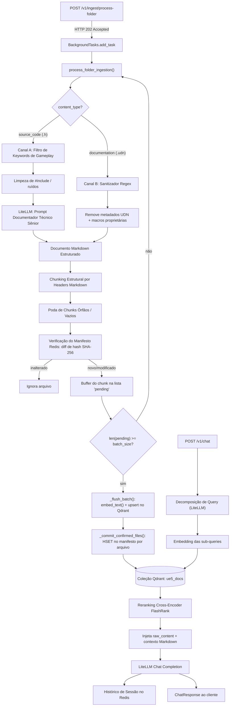

[English](./README.md) | Português (BR)

---

# Pipeline de Ingestão Unreal Code-to-Doc
 
### Motor de ETL Assíncrono de Alta Performance para Destilar Código-Fonte da Unreal Engine 5 em Documentação Semântica para RAG
 


 
---
 
## Visão Geral
 
A árvore de código-fonte da Unreal Engine 5 é monstruosa, profundamente aninhada e escrita para um compilador — não para um modelo de linguagem. Alimentar diretamente arquivos `.h` brutos ou documentação oficial `.udn` em um banco de dados vetorial produz um corpus poluído com ruído de `#include`, boilerplate de modificadores de acesso, macros proprietárias de markup e fragmentos órfãos. O resultado é um sistema de Retrieval-Augmented Generation (RAG) que recupera chunks sintaticamente semelhantes, porém semanticamente inúteis, levando um LLM downstream a alucinar ou se contradizer.
 
Este repositório implementa um **pipeline de ETL Code-to-Doc**: um serviço FastAPI assíncrono que varre um diretório montado da Unreal Engine, aplica filtragem estrutural agressiva, transforma headers C++ brutos em documentação Markdown orientada a gameplay via LLM, sanitiza a documentação oficial `.udn` por meio de regex puro (sem chamada de LLM) e indexa os chunks resultantes no **Qdrant** com um manifesto de idempotência apoiado em **Redis**.
 
O sistema foi construído com o propósito específico de alimentar um assistente RAG downstream (`POST /v1/chat`) capaz de responder perguntas precisas de programação de gameplay em UE5 — fundamentado em símbolos reais da engine, não em conhecimento genérico da web.
 
---
 
## Principais Funcionalidades
 
- **Motor de Ingestão de Duplo Canal** — `content_type: source_code` roteia arquivos `.h` pelo **Canal A** (documentador técnico via LLM); `content_type: documentation` roteia arquivos `.udn` pelo **Canal B** (sanitização puramente regex, custo zero de LLM).
- **Manifesto de Idempotência apoiado em Redis** — a identidade de cada arquivo-fonte é rastreada como um hash SHA-256 em uma Hash do Redis (`manifest:{collection_name}`), indexada pelo caminho relativo. Arquivos inalterados são ignorados integralmente em reingestões; arquivos modificados disparam a limpeza de chunks órfãos no Qdrant antes da reindexação.
- **Fronteira de Commit Atômico (`_PendingFileCommit`)** — os chunks são acumulados entre arquivos e enviados ao Qdrant em lotes por eficiência de rede, mas o manifesto **nunca** é atualizado a partir de contagens agregadas em memória. Cada arquivo é rastreado individualmente (`total_chunks` vs. `confirmed_chunks`); somente quando todos os chunks de um arquivo forem confirmadamente inseridos é que seu hash é commitado. Uma queda no meio de um lote não deixa nenhum checkpoint mentiroso — o arquivo é simplesmente reprocessado do zero na próxima execução.
- **Filtragem Estrutural Agressiva na Origem** — diretórios como `Private`, `ThirdParty`, `Intermediate`, `Binaries`, `Saved` e `.git` são excluídos da varredura (`_IGNORED_DIR_NAMES`); o Canal A ainda se restringe a headers contendo símbolos relevantes de gameplay (`_GAMEPLAY_KEYWORDS`: `Character`, `Pawn`, `Actor`, `Component`, `GameMode`, `PlayerController`, `Subsystem`, entre outros).
- **Poda de Chunks Órfãos/Vazios** — após o chunking estrutural por headers Markdown, qualquer chunk reduzido a uma única linha de cabeçalho órfão (ex.: um título `#` truncado sem corpo) é descartado antes mesmo de chegar à etapa de embedding, economizando diretamente tokens de API de embedding.
- **Quarentena por Falhas Consecutivas** — um arquivo que falha `INGESTION_MAX_CONSECUTIVE_FAILURES` vezes seguidas (padrão: 3) é automaticamente colocado em quarentena e ignorado nas execuções subsequentes, evitando desperdício de chamadas de LLM/embedding em um arquivo permanentemente quebrado até intervenção manual.
- **Lock Distribuído no Redis por Coleção** — `ingestion_lock_key` serializa execuções concorrentes de `process_folder_ingestion` sobre a mesma coleção do Qdrant, com um TTL autoexpirável (`INGESTION_LOCK_TIMEOUT_SECONDS`, padrão 3600s) como rede de segurança contra locks órfãos deixados por processos que morreram.
- **Enriquecimento de Payload para RAG Híbrido** — o vetor de embedding é sempre gerado a partir do Markdown sintetizado pela LLM (`chunk["text"]`), mas o payload do Qdrant armazena adicionalmente `raw_content` — o conteúdo original e integral do arquivo-fonte (header C++ já limpo ou `.udn` já sanitizado) — que o `rag_service.py` injeta posteriormente como uma fonte soberana de "Referência Direta", para sintaxe exata (assinaturas, macros `UPROPERTY`/`UFUNCTION`), complementando o resumo conceitual.
- **Ingestão Não-Bloqueante via BackgroundTasks** — `POST /v1/ingest/process-folder` executa apenas uma verificação síncrona barata (`Path.is_dir()`) e retorna **HTTP 202 Accepted** imediatamente; a varredura completa do sistema de arquivos, as chamadas de LLM, a geração de embeddings e os upserts no Qdrant rodam depois via `BackgroundTasks` do FastAPI, despachados através de `asyncio.to_thread()` para operações de I/O bloqueantes, garantindo que o mesmo event loop que atende `/v1/chat` nunca seja bloqueado.
- **Chamadas de Embedding Resilientes** — `embed_text()` envolve cada chamada ao endpoint `/embeddings` do LiteLLM em uma política de retry via `tenacity`, com backoff exponencial e jitter (`litellm_max_retries`, padrão 4), tolerante a HTTP 429/500/502/503/504 e timeouts — crítico quando uma única execução de ingestão pode disparar dezenas de milhares de chamadas de embedding.
- **Reranking Avançado no RAG** — o pipeline de chat sobrepõe um cross-encoder **FlashRank** (`ms-marco-MiniLM-L-12-v2`) rodando exclusivamente em CPU sobre a busca vetorial, melhorando a precisão da recuperação sem qualquer dependência de GPU.
---
 
## Arquitetura e Fluxo de Dados
 

 
**Fluxo narrativo:**
 
1. Um cliente chama `POST /v1/ingest/process-folder` com um `folder_path` (absoluto, **dentro** do container `ue5-agent`) e um `content_type`. O endpoint valida que o diretório existe e retorna imediatamente `IngestAcceptedResponse` (HTTP 202).
2. `process_folder_ingestion()` adquire um lock distribuído no Redis (`ingestion_lock_key`) escopado à coleção do Qdrant, carrega os caches de manifesto e de falhas, e então descobre recursivamente todos os arquivos `.h` ou `.udn` (`_discover_files`), ignorando diretórios excluídos.
3. O hash SHA-256 de cada arquivo é comparado ao manifesto no Redis. Arquivos inalterados são ignorados; arquivos novos ou modificados disparam a exclusão de quaisquer chunks órfãos existentes no Qdrant (`_delete_file_chunks`) antes da regeneração.
4. O **Canal A** (`source_code`) aplica o filtro de keywords de gameplay, remove instruções `#include` e linhas em branco excessivas, trunca headers excepcionalmente grandes (`ingestion_max_header_chars`) e chama a LLM configurada em `INGESTION_DOCUMENTER_MODEL` com o `_DOCUMENTER_SYSTEM_PROMPT` — uma persona de "Documentador Técnico Sênior da Epic Games" que produz Markdown estruturado.
5. O **Canal B** (`documentation`) remove campos de metadados `.udn` (`Availability`, `Title`, `Crumbs`, etc.) e macros proprietárias entre colchetes apenas via regex — sem invocação de LLM, sem custo de tokens.
6. Ambos os canais convergem para o chunking estrutural por headers Markdown, seguido da etapa de poda de chunks órfãos/vazios.
7. Os chunks se acumulam em um buffer compartilhado `pending`; ao atingir `ingestion_batch_size`, `_flush_batch()` gera embeddings concorrentemente (limitado por `ingestion_embedding_concurrency`) e executa um upsert atômico no Qdrant.
8. Somente após **todos** os chunks de um arquivo serem confirmadamente inseridos, `_commit_confirmed_files()` grava seu hash no manifesto do Redis — garantindo que o checkpoint jamais minta sobre progresso parcial.
9. No lado da recuperação, `POST /v1/chat` decompõe a pergunta do usuário em sub-queries em inglês técnico, gera seus embeddings, recupera candidatos do Qdrant, reordena com FlashRank, injeta tanto o Markdown sintetizado quanto o campo de payload `raw_content` no prompt, e chama a LLM via LiteLLM — persistindo o turno de conversa no Redis (`session_service.py`) para memória multi-turno.
---
 
## Stack Tecnológica
 
| Tecnologia | Papel no Pipeline |
|---|---|
| **Python 3.12** | Runtime principal; design assíncrono em toda a base de código. |
| **FastAPI** | Camada HTTP, validação de requisições via Pydantic, injeção de dependência para os clientes Qdrant/Redis. |
| **BackgroundTasks** | Mecanismo nativo do FastAPI usado para executar o pipeline de ingestão completo fora do ciclo de requisição/resposta. |
| **Qdrant (`v1.9.2`)** | Banco de dados vetorial que armazena embeddings de alta dimensão e payloads enriquecidos (`raw_content`, caminho de origem, versão da UE). |
| **Redis 7 (alpine)** | Manifesto de idempotência (rastreamento de hash de arquivos), rastreamento de falhas consecutivas, lock distribuído de ingestão e histórico/TTL de sessões de chat. |
| **LiteLLM Proxy** | Ponte compatível com OpenAI para LLMs locais/remotos (ex.: `ollama/qwen2.5-coder:7b`, `gemini/gemini-2.0-flash-lite`), usada tanto pelo documentador do Canal A quanto pelo modelo de chat. |
| **httpx** | Cliente HTTP assíncrono para toda a comunicação com LiteLLM/Ollama. |
| **tenacity** | Backoff exponencial com jitter em torno de falhas transitórias de embedding/completion (HTTP 429/5xx, timeouts). |
| **FlashRank** | Reranker cross-encoder leve, rodando exclusivamente em CPU (`ms-marco-MiniLM-L-12-v2`), melhorando a precisão da recuperação sem dependência de GPU. |
| **Docker Compose** | Orquestra `qdrant`, `qdrant-healthcheck` (sidecar alpine), `agent-redis` e o serviço FastAPI `ue5-agent` em redes bridge isoladas. |
 
---
 
## Como Executar o Projeto
 
### Pré-requisitos
 
- Docker e Docker Compose.
- Um **proxy LiteLLM** em execução, acessível pela rede externa `litellm_public` do Docker, configurado com seu modelo de embedding (ex.: `mxbai-embed-large` via Ollama) e modelos de chat/completion.
- A árvore de código-fonte da Unreal Engine 5 (ou um subconjunto dela) acessível no host, para ser montada em modo somente-leitura dentro do container.
### 1. Clonar o repositório
 
```bash
git clone <url-do-repositorio>
cd <diretorio-do-repositorio>
```
 
### 2. Configurar as variáveis de ambiente
 
Copie o template e preencha os segredos obrigatórios:
 
```bash
cp .env.example .env
```
 
```env
# .env
 
AGENT_REDIS_PASSWORD=troque-por-uma-senha-forte
 
LITELLM_MASTER_KEY=sk-sua-chave-litellm
 
APP_ENV=development
LOG_LEVEL=DEBUG
EMBEDDING_MODEL=ollama-embed
 
# --- Ingestão — Pipeline ETL Code-to-Doc (POST /v1/ingest/process-folder) ---
# Modelo LiteLLM rápido/barato usado para transformar headers .h em
# documentação Markdown educacional (Canal A). Deve estar configurado
# no config.yaml do LiteLLM.
INGESTION_DOCUMENTER_MODEL=gemini/gemini-2.0-flash-lite
 
# Opcionais — descomente para sobrescrever os defaults em app/core/config.py
# INGESTION_BATCH_SIZE=32
# INGESTION_EMBEDDING_CONCURRENCY=8
# INGESTION_MAX_CHUNK_CHARS=3000
# INGESTION_DEFAULT_UE_VERSION=5.8
```
 
### 3. Montar a árvore de código-fonte da Unreal Engine
 
No `docker-compose.yml`, ajuste o volume montado no serviço `ue5-agent` para apontar para sua instalação local da UE5 (somente-leitura):
 
```yaml
volumes:
  - /caminho/para/UE_5.8/Engine:/data/ue5_engine_root:ro
```
 
### 4. Construir e subir a stack
 
```bash
docker compose up -d --build
```
 
Isso provisiona:
- `ue5-qdrant` — o banco de dados vetorial (portas `6333`/`6334`).
- `ue5-qdrant-healthcheck` — um sidecar Alpine que faz polling em `/healthz`, já que a imagem distroless do Qdrant não possui ferramentas nativas de healthcheck.
- `ue5-agent-redis` — memória de sessão e armazenamento do manifesto de ingestão.
- `ue5-agent-api` — o serviço FastAPI (porta `8000`), que só inicia após ambas as dependências reportarem estado saudável.
### 5. Validar a stack
 
```bash
python scripts/validate_stack.py --api-url http://localhost:8000 --verbose
```
 
### 6. Disparar uma execução de ingestão
 
```bash
curl -X POST http://localhost:8000/v1/ingest/process-folder \
  -H "Content-Type: application/json" \
  -d '{
        "folder_path": "/data/ue5_engine_root/Source/Runtime",
        "content_type": "source_code"
      }'
```
 
Acompanhe o progresso pelos logs da aplicação (nível `INFO`).
 
---
 
## Endpoints Principais da API
 
| Método | Rota | Descrição |
|---|---|---|
| `POST` | `/v1/ingest/process-folder` | Dispara o pipeline de ETL Code-to-Doc de duplo canal em background para uma pasta informada. Retorna **HTTP 202** com um `IngestAcceptedResponse` (`task_id`, `folder_path`, `content_type`, `accepted_at`). Corpo: `IngestRequest { folder_path: str, content_type: "source_code" \| "documentation", ue_version?: str }`. |
| `POST` | `/v1/chat` | Executa o pipeline RAG completo: decomposição de query, embedding, recuperação no Qdrant, reranking via FlashRank, completion via LiteLLM e memória de sessão apoiada em Redis. Corpo: `ChatRequest { message: str, session_id: str, model: str, top_k: int }`. |
| `GET` | `/v1/health` | Health check ativo contra Qdrant, Redis e o proxy LiteLLM em paralelo (`asyncio.gather`). Retorna **200** se todas as dependências reportarem `ok`/`degraded`, ou **503** se alguma reportar `error`. |
 
---
 
## Roadmap / Próximos Passos
 
- **Respostas de Chat em Streaming** — o campo `stream: true`, já reservado em `ChatRequest`, aguarda uma futura implementação via Server-Sent Events sobre `/v1/chat`.
- **API de Progresso de Ingestão** — expor progresso em tempo real (arquivos processados, chunks indexados, arquivo atual) via um endpoint de status dedicado ou WebSocket, substituindo a observabilidade atual baseada apenas em logs.
- **Instrumentação Prometheus** — ativar a dependência já referenciada `prometheus-fastapi-instrumentator` para métricas de throughput de ingestão e latência do RAG.
- **Reenfileiramento Automatizado de Falhas** — disponibilizar um endpoint administrativo para limpar arquivos em quarentena (hoje um `HDEL` manual no Redis) e disparar reprocessamento direcionado.
- **Roteamento Multi-Coleção** — estender o manifesto e as chaves de lock (já escopadas por coleção) para suportar ingestão paralela de múltiplas versões da Unreal Engine em coleções isoladas do Qdrant.
- **Ativação da Suíte de Testes** — promover as dependências comentadas `pytest`/`pytest-asyncio` para um pipeline de CI ativo, cobrindo a lógica de filtragem de duplo canal e o comportamento do manifesto de idempotência.
