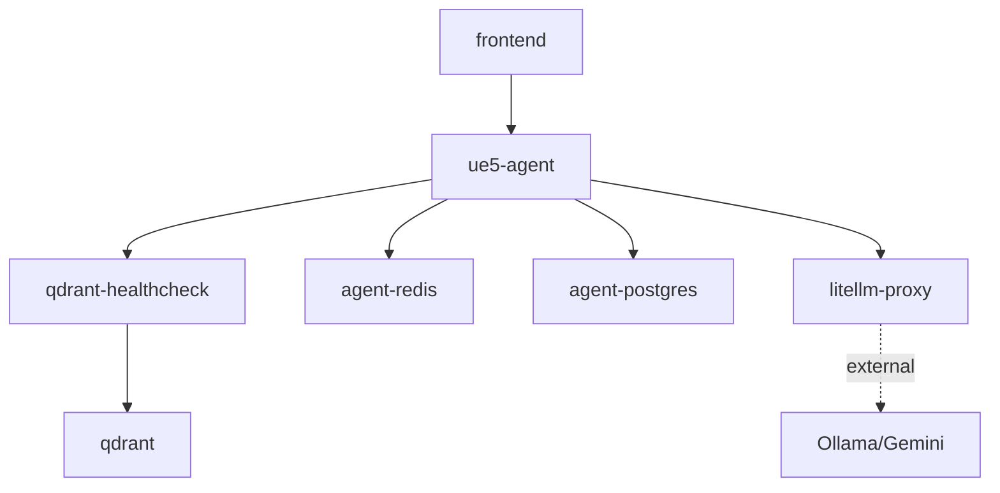
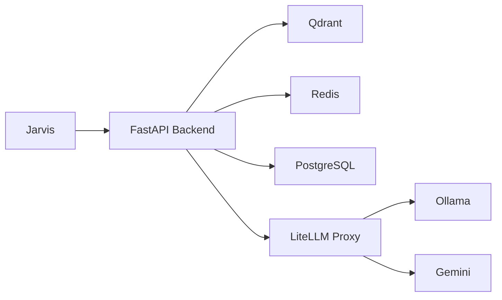

# Any Assistant AI — Jarvis Integration Schema

> **Document Version**: 1.0  
> **Generated**: 2026-08-31  
> **Repository**: `/home/bernardo/workspaces/any-assistant`

---

# Project Identity

## Canonical Name
**Any Assistant AI**

## Legacy Identifiers
- UE5 AI Assistant
- ue5-agent
- UE5 RAG Assistant

## Description
A multi-tenant, multi-domain AI assistant platform powered by Advanced Retrieval-Augmented Generation (RAG). Currently supports Unreal Engine 5 and Godot 4 with extensible architecture for additional game engines and technical domains.

## Purpose
Provides technical Q&A about game engine architecture, APIs, and best practices by grounding LLM responses in a semantically curated knowledge base. Transforms source code and documentation into LLM-generated technical documentation before indexing.

## Role in Ecosystem
Primary RAG-based Q&A service for game engine technical documentation. Acts as a knowledge retrieval layer that can be orchestrated by Jarvis to answer technical questions, ingest new documentation, and manage multi-tenant knowledge bases.

## Technical Stack

| Layer | Technology |
|-------|------------|
| **Backend** | Python 3.12, FastAPI 0.115.5, SQLAlchemy 2.0.36 (async), Pydantic 2.10.3 |
| **Frontend** | React 19, TypeScript 5.8, Vite 6, Tailwind CSS v4, Zustand 5.0.14 |
| **Vector DB** | Qdrant 1.18.0 |
| **Cache** | Redis 7 Alpine |
| **Persistence** | PostgreSQL 16 Alpine |
| **LLM Gateway** | LiteLLM Proxy (external) |
| **Reranker** | FlashRank (ONNX, CPU-only) |

## Architecture Overview

```
┌─────────────────────────────────────────────────────────────────────────────┐
│                              FRONTEND LAYER                                  │
│  React 19 + Vite + TypeScript + Tailwind CSS (Port 3001)                   │
└─────────────────────────────────────────────────────────────────────────────┘
                                      │
                                      ▼
┌─────────────────────────────────────────────────────────────────────────────┐
│                              API LAYER                                       │
│  FastAPI (Port 8000)                                                        │
│  • /v1/chat              • /v1/sessions                                    │
│  • /v1/ingest/*          • /v1/admin/*                                     │
│  • /v1/health            • /v1/chat/models                                 │
└─────────────────────────────────────────────────────────────────────────────┘
                                      │
          ┌───────────────────────────┼───────────────────────────┐
          ▼                           ▼                           ▼
┌──────────────────┐    ┌──────────────────────┐    ┌──────────────────────┐
│  Qdrant          │    │  Redis               │    │  PostgreSQL          │
│  Vector DB       │    │  Session cache       │    │  Persistent storage  │
│  (Port 6333)     │    │  Ingestion locks     │    │  Multi-tenant data   │
└──────────────────┘    └──────────────────────┘    └──────────────────────┘
          │
          ▼
┌─────────────────────────────────────────────────────────────────────────────┐
│                          LLM ORCHESTRATION                                   │
│  LiteLLM Proxy (Port 4000 - External)                                       │
│  Routes to: Ollama (local) | Gemini (cloud) | OpenAI (cloud)               │
└─────────────────────────────────────────────────────────────────────────────┘
```

## Services, Ports, Containers

| Service | Container Name | Port | Purpose |
|---------|---------------|------|---------|
| `frontend` | `ue5-frontend` | 3001 | React SPA (Nginx) |
| `ue5-agent` | `ue5-agent-api` | 8000 | FastAPI backend |
| `qdrant` | `ue5-qdrant` | 6333 (HTTP), 6334 (gRPC) | Vector database |
| `agent-redis` | `ue5-agent-redis` | 6379 (internal) | Session cache, ingestion locks |
| `agent-postgres` | `ue5-agent-postgres` | 5432 (internal) | Persistent storage |
| `qdrant-healthcheck` | `ue5-qdrant-healthcheck` | - | Sidecar health monitor |

## Networks
- `assistant_internal` (bridge) — Internal service communication
- `litellm_public` (external) — LiteLLM proxy connection

---

# Jarvis Integration Summary

```yaml
project_id: any-assistant
integration_readiness: full

preferred_interface:
  type: rest
  base_url: http://ue5-agent-api:8000/v1

supports:
  synchronous_commands: true
  async_jobs: true
  progress_tracking: partial
  cancellation: false
  webhooks: false
  sse: true

primary_capabilities:
  - chat_query
  - session_list
  - session_get
  - session_delete
  - ingestion_trigger
  - health_check
  - models_list
  - tenant_create
  - tenant_list
  - tenant_get
  - tenant_update
  - tenant_delete
  - api_key_create
  - api_key_list
  - api_key_revoke
  - collection_create
  - collection_list
  - collection_get
  - collection_update
  - collection_delete
```

## What Jarvis Can Do

1. **Query Technical Knowledge** — Ask questions about UE5/Godot 4 and receive grounded answers with citations
2. **Manage Sessions** — List, retrieve, and delete conversation histories
3. **Ingest Documentation** — Trigger background ingestion of source code/documentation
4. **Administer Tenants** — Create/update/delete tenants and their API keys
5. **Manage Collections** — Configure Qdrant collections per tenant
6. **Monitor Health** — Check service availability and dependency status

## Interface Preferences

| Operation | Preferred Interface | Notes |
|-----------|---------------------|-------|
| Chat queries | `POST /v1/chat` (SSE for streaming) | Core functionality |
| Session management | `GET/DELETE /v1/sessions/*` | Synchronous |
| Ingestion | `POST /v1/ingest/process-folder` | Returns 202, runs in background |
| Health checks | `GET /v1/health` | No auth required |
| Admin operations | `/v1/admin/*` | Requires admin API key |

## Async Operations

| Operation | Duration | Tracking | Completion Detection |
|-----------|----------|----------|---------------------|
| Chat (non-streaming) | 5-30s | N/A (single request) | HTTP 200 response |
| Chat (streaming) | 5-30s | SSE events | `type: "done"` event |
| Ingestion | Minutes to hours | Redis lock + manifest | Lock released + logs |

## Operations Requiring Care

- **Ingestion** — Long-running, writes to vector DB, calls LLM for documentation
- **Tenant deletion** — Cascade deletes all associated data
- **Collection deletion** — Removes Qdrant collection config (not the actual Qdrant data)
- **API key revocation** — Immediately invalidates the key

---

# Capability Inventory

## Chat & RAG

### Capability: Chat Query

**Human Name**: Chat with AI Assistant  
**Proposed Jarvis Tool Name**: `any_assistant.chat.query`

**Description**: Send a question to the AI assistant and receive an answer grounded in game engine documentation. Supports streaming via SSE.

**Interface**: 
```
POST /v1/chat
```

**Input Parameters**:

| Parameter | Type | Required | Default | Description |
|-----------|------|----------|---------|-------------|
| `message` | string | Yes | — | User question (1-8000 chars) |
| `session_id` | string (UUID) | No | Auto-generated | Session for context continuity |
| `tenant_id` | string (UUID) | No | Default tenant | Tenant identifier |
| `collection_name` | string | No | Default collection | Collection within tenant |
| `domain_id` | string | No | `godot_4` | Domain: `godot_4` or `ue5` |
| `model` | string | No | `ollama/qwen2.5-coder:7b` | LLM model override |
| `top_k` | integer | No | 5 | Chunks to retrieve (1-20) |
| `project_source_filter` | string | No | None | Filter by project source |
| `stream` | boolean | No | false | Enable SSE streaming |

**Output Structure**:
```json
{
  "session_id": "uuid",
  "answer": "string",
  "model_used": "string",
  "retrieved_chunks": [
    {
      "score": 0.95,
      "summary_markdown": "string",
      "title": "string",
      "description": "string",
      "source_file": "string",
      "chunk_id": 0,
      "ue_version": "string",
      "doc_type": "string",
      "project_source": "string",
      "raw_content": "string"
    }
  ],
  "prompt_tokens": 1234,
  "completion_tokens": 567,
  "finish_reason": "stop",
  "created_at": "2026-08-31T00:00:00Z"
}
```

**Side Effects**:
- Creates/updates session in PostgreSQL
- Stores message history
- Updates Redis session cache

**Async Behavior**: 
- Synchronous by default
- Streaming via SSE when `stream: true`

**Tracking Mechanism**: 
- `session_id` for conversation continuity
- `finish_reason` for completion status

**Completion/Failure Conditions**:
- **Success**: `finish_reason: "stop"`
- **Truncated**: `finish_reason: "length"`
- **Error**: `finish_reason: "content_filter"` or HTTP error

**Risk Level**: `SAFE_WRITE`

---

### Capability: List Models

**Human Name**: List Available LLM Models  
**Proposed Jarvis Tool Name**: `any_assistant.models.list`

**Description**: List LLM models available through the LiteLLM proxy.

**Interface**: 
```
GET /v1/chat/models
```

**Input Parameters**: None

**Output Structure**:
```json
[
  { "id": "ollama/qwen2.5-coder:7b", "object": "model" },
  { "id": "gemini-3.5-flash-lite", "object": "model" }
]
```

**Side Effects**: None

**Async Behavior**: Synchronous

**Risk Level**: `READ_ONLY`

---

## Session Management

### Capability: List Sessions

**Human Name**: List Chat Sessions  
**Proposed Jarvis Tool Name**: `any_assistant.sessions.list`

**Description**: Retrieve list of chat sessions for the authenticated tenant.

**Interface**: 
```
GET /v1/sessions
```

**Input Parameters**: None (tenant from auth context)

**Output Structure**:
```json
[
  {
    "id": "uuid",
    "title": "string",
    "default_model": "string",
    "project_source_filter": "string|null",
    "is_archived": false,
    "created_at": "timestamp",
    "updated_at": "timestamp"
  }
]
```

**Side Effects**: None

**Async Behavior**: Synchronous

**Risk Level**: `READ_ONLY`

---

### Capability: Get Session

**Human Name**: Get Session Details  
**Proposed Jarvis Tool Name**: `any_assistant.sessions.get`

**Description**: Retrieve a specific chat session with all messages and citations.

**Interface**: 
```
GET /v1/sessions/{session_id}
```

**Input Parameters**:

| Parameter | Type | Required | Description |
|-----------|------|----------|-------------|
| `session_id` | string (UUID) | Yes | Session identifier |

**Output Structure**: Session with messages array

**Side Effects**: None

**Risk Level**: `READ_ONLY`

---

### Capability: Delete Session

**Human Name**: Delete Chat Session  
**Proposed Jarvis Tool Name**: `any_assistant.sessions.delete`

**Description**: Delete a chat session and all associated messages.

**Interface**: 
```
DELETE /v1/sessions/{session_id}
```

**Input Parameters**:

| Parameter | Type | Required | Description |
|-----------|------|----------|-------------|
| `session_id` | string (UUID) | Yes | Session identifier |

**Output Structure**: HTTP 204 No Content

**Side Effects**:
- Deletes session from PostgreSQL (cascade)
- Redis cache expires naturally

**Async Behavior**: Synchronous

**Risk Level**: `SAFE_WRITE` (destructive but scoped)

---

## Ingestion

### Capability: Trigger Ingestion

**Human Name**: Ingest Documentation Folder  
**Proposed Jarvis Tool Name**: `any_assistant.ingestion.process_folder`

**Description**: Trigger background ingestion of source code or documentation into the vector database.

**Interface**: 
```
POST /v1/ingest/process-folder
```

**Input Parameters**:

| Parameter | Type | Required | Default | Description |
|-----------|------|----------|---------|-------------|
| `folder_path` | string | Yes | — | Absolute path inside container |
| `content_type` | string | Yes | — | `source_code` or `documentation` |
| `project_source` | string | Yes | — | Provenance label |
| `domain_id` | string | No | `godot_4` | Domain identifier |
| `engine_version` | string | No | Auto-detected | Engine version override |
| `sample_mode` | boolean | No | false | Enable for sample projects |

**Output Structure**:
```json
{
  "message": "string",
  "folder_path": "string",
  "content_type": "string",
  "project_source": "string",
  "sample_mode": false
}
```

**Side Effects**:
- Writes to Qdrant (upsert points)
- Writes to Redis (manifest, locks)
- May call LiteLLM for documentation generation
- Creates/updates collection if needed

**Async Behavior**: 
- Returns immediately with `202 Accepted`
- Runs in background via FastAPI BackgroundTasks

**Tracking Mechanism**:
- Redis lock presence indicates running job
- Redis manifest tracks processed files
- Check container logs for progress

**Completion/Failure Conditions**:
- **Success**: Lock released, manifest updated
- **Partial**: Some files quarantined after failures
- **Failure**: Lock timeout, critical error

**Risk Level**: `HIGH_RISK` (long-running, writes to vector DB)

---

## Health & Diagnostics

### Capability: Health Check

**Human Name**: System Health Check  
**Proposed Jarvis Tool Name**: `any_assistant.system.health`

**Description**: Check health status of all system components.

**Interface**: 
```
GET /v1/health
```

**Input Parameters**: None

**Output Structure**:
```json
{
  "status": "ok|degraded|error",
  "version": "0.2.0",
  "environment": "production",
  "dependencies": {
    "qdrant": { "status": "ok", "latency_ms": 5.2 },
    "redis": { "status": "ok", "latency_ms": 1.3 },
    "litellm": { "status": "ok", "latency_ms": 120.5 }
  },
  "timestamp": "2026-08-31T00:00:00Z"
}
```

**What Jarvis Can Conclude**:
- `status: "ok"` — All services operational
- `status: "degraded"` — Some services slow or partially available
- `status: "error"` — One or more services down

**Side Effects**: None

**Async Behavior**: Synchronous

**Risk Level**: `READ_ONLY`

---

## Tenant Administration

### Capability: Create Tenant

**Human Name**: Create Tenant  
**Proposed Jarvis Tool Name**: `any_assistant.admin.tenant_create`

**Description**: Create a new tenant with isolated configuration.

**Interface**: 
```
POST /v1/admin/tenants
```

**Required Auth**: Admin API key

**Input Parameters**:

| Parameter | Type | Required | Description |
|-----------|------|----------|-------------|
| `slug` | string | Yes | Unique identifier (a-z0-9_-) |
| `name` | string | Yes | Display name |
| `description` | string | No | Description |
| `rate_limit_rpm` | integer | No | Requests per minute limit |
| `rate_limit_tpm` | integer | No | Tokens per minute limit |

**Output Structure**:
```json
{
  "id": "uuid",
  "slug": "string",
  "name": "string",
  "is_active": true,
  "collections_count": 0,
  "api_keys_count": 0
}
```

**Side Effects**: Creates tenant record in PostgreSQL

**Async Behavior**: Synchronous

**Risk Level**: `SAFE_WRITE`

---

### Capability: List Tenants

**Human Name**: List Tenants  
**Proposed Jarvis Tool Name**: `any_assistant.admin.tenant_list`

**Description**: List all tenants with pagination.

**Interface**: 
```
GET /v1/admin/tenants
```

**Required Auth**: Admin API key

**Input Parameters**:

| Parameter | Type | Required | Default | Description |
|-----------|------|----------|---------|-------------|
| `page` | integer | No | 1 | Page number |
| `page_size` | integer | No | 20 | Items per page (max 100) |
| `is_active` | boolean | No | None | Filter by active status |

**Output Structure**: Paginated list with `items`, `total`, `page`, `page_size`

**Side Effects**: None

**Risk Level**: `READ_ONLY`

---

### Capability: Get Tenant

**Human Name**: Get Tenant Details  
**Proposed Jarvis Tool Name**: `any_assistant.admin.tenant_get`

**Interface**: 
```
GET /v1/admin/tenants/{tenant_id}
```

**Required Auth**: Admin API key

**Risk Level**: `READ_ONLY`

---

### Capability: Update Tenant

**Human Name**: Update Tenant  
**Proposed Jarvis Tool Name**: `any_assistant.admin.tenant_update`

**Interface**: 
```
PATCH /v1/admin/tenants/{tenant_id}
```

**Required Auth**: Admin API key

**Modifiable Fields**: `name`, `description`, `is_active`, `rate_limit_rpm`, `rate_limit_tpm`

**Risk Level**: `SAFE_WRITE`

---

### Capability: Delete Tenant

**Human Name**: Delete Tenant  
**Proposed Jarvis Tool Name**: `any_assistant.admin.tenant_delete`

**Interface**: 
```
DELETE /v1/admin/tenants/{tenant_id}
```

**Required Auth**: Admin API key

**Side Effects**: Cascade deletes all collections, API keys, configs

**Constraints**: Cannot delete the `default` tenant

**Risk Level**: `HIGH_RISK` (destructive, cascade)

---

## API Key Administration

### Capability: Create API Key

**Human Name**: Create API Key  
**Proposed Jarvis Tool Name**: `any_assistant.admin.api_key_create`

**Description**: Generate a new API key for a tenant.

**Interface**: 
```
POST /v1/admin/tenants/{tenant_id}/api-keys
```

**Required Auth**: Admin API key

**Input Parameters**:

| Parameter | Type | Required | Description |
|-----------|------|----------|-------------|
| `name` | string | Yes | Key name |
| `is_admin` | boolean | No | Admin privileges |
| `is_read_only` | boolean | No | Read-only access |
| `expires_at` | string (ISO 8601) | No | Expiration date |

**Output Structure**:
```json
{
  "id": "uuid",
  "name": "string",
  "key": "ue5_XXXX...",  // SHOWN ONLY ONCE
  "key_prefix": "ue5_XXXX",
  "is_admin": false,
  "is_read_only": false,
  "is_active": true
}
```

**Side Effects**: Creates API key record with bcrypt hash

**Risk Level**: `HIGH_RISK` (security-sensitive)

---

### Capability: List API Keys

**Human Name**: List API Keys  
**Proposed Jarvis Tool Name**: `any_assistant.admin.api_key_list`

**Interface**: 
```
GET /v1/admin/tenants/{tenant_id}/api-keys
```

**Required Auth**: Admin API key

**Risk Level**: `READ_ONLY`

---

### Capability: Revoke API Key

**Human Name**: Revoke API Key  
**Proposed Jarvis Tool Name**: `any_assistant.admin.api_key_revoke`

**Interface**: 
```
DELETE /v1/admin/tenants/{tenant_id}/api-keys/{key_id}
```

**Required Auth**: Admin API key

**Risk Level**: `HIGH_RISK` (immediately invalidates key)

---

## Collection Administration

### Capability: Create Collection

**Human Name**: Create Collection  
**Proposed Jarvis Tool Name**: `any_assistant.admin.collection_create`

**Description**: Create a new Qdrant collection configuration for a tenant.

**Interface**: 
```
POST /v1/admin/collections
```

**Required Auth**: Admin API key

**Input Parameters**:

| Parameter | Type | Required | Description |
|-----------|------|----------|-------------|
| `tenant_id` | string (UUID) | Yes | Owner tenant |
| `name` | string | Yes | Internal name |
| `qdrant_collection_name` | string | Yes | Actual Qdrant collection |
| `domain_id` | string | No | Domain: `godot_4` or `ue5` |
| `display_name` | string | Yes | Display name |
| `description` | string | No | Description |
| `default_project_source_filter` | string | No | Default filter |

**Risk Level**: `SAFE_WRITE`

---

### Capability: List Collections

**Human Name**: List Collections  
**Proposed Jarvis Tool Name**: `any_assistant.admin.collection_list`

**Interface**: 
```
GET /v1/admin/collections
```

**Required Auth**: Admin API key

**Risk Level**: `READ_ONLY`

---

### Capability: Get Collection

**Human Name**: Get Collection Details  
**Proposed Jarvis Tool Name**: `any_assistant.admin.collection_get`

**Interface**: 
```
GET /v1/admin/collections/{collection_id}
```

**Required Auth**: Admin API key

**Risk Level**: `READ_ONLY`

---

### Capability: Update Collection

**Human Name**: Update Collection  
**Proposed Jarvis Tool Name**: `any_assistant.admin.collection_update`

**Interface**: 
```
PATCH /v1/admin/collections/{collection_id}
```

**Required Auth**: Admin API key

**Modifiable Fields**: `display_name`, `description`, `is_active`, `default_project_source_filter`

**Risk Level**: `SAFE_WRITE`

---

### Capability: Delete Collection

**Human Name**: Delete Collection  
**Proposed Jarvis Tool Name**: `any_assistant.admin.collection_delete`

**Interface**: 
```
DELETE /v1/admin/collections/{collection_id}
```

**Required Auth**: Admin API key

**Side Effects**: Removes collection record (NOT the actual Qdrant data)

**Risk Level**: `HIGH_RISK` (destructive)

---

# HTTP / API Surface

## Router Organization

```
/v1
├── /health                    [GET]     — Health check
├── /chat
│   ├── ""                    [POST]    — Chat query
│   └── /models               [GET]     — List models
├── /ingest
│   └── /process-folder       [POST]    — Trigger ingestion
├── /sessions
│   ├── ""                    [GET]     — List sessions
│   ├── /{session_id}         [GET]     — Get session
│   └── /{session_id}         [DELETE]  — Delete session
└── /admin
    ├── /tenants              [GET, POST]
    ├── /tenants/{id}         [GET, PATCH, DELETE]
    ├── /tenants/{id}/api-keys [GET, POST]
    ├── /tenants/{id}/api-keys/{key_id} [DELETE]
    ├── /collections          [GET, POST]
    └── /collections/{id}     [GET, PATCH, DELETE]
```

## Endpoint Details

### POST /v1/chat

| Attribute | Value |
|-----------|-------|
| **Purpose** | Main RAG chat endpoint |
| **Auth** | Optional (X-API-Key header) |
| **Request Body** | `ChatRequest` |
| **Response** | `ChatResponse` or `StreamingResponse` |
| **HTTP Status** | 200 (success), 503 (LLM unavailable), 500 (internal error) |
| **Source** | `app/api/v1/endpoints/chat.py::chat()` |

### GET /v1/health

| Attribute | Value |
|-----------|-------|
| **Purpose** | System health check |
| **Auth** | None (exempt) |
| **Response** | `HealthResponse` |
| **HTTP Status** | 200 (ok/degraded), 503 (error) |
| **Source** | `app/api/v1/endpoints/health.py::health_check()` |

### POST /v1/ingest/process-folder

| Attribute | Value |
|-----------|-------|
| **Purpose** | Trigger background ingestion |
| **Auth** | Optional |
| **Request Body** | `IngestRequest` |
| **Response** | `IngestAcceptedResponse` |
| **HTTP Status** | 202 (accepted), 400 (invalid path) |
| **Source** | `app/api/v1/endpoints/ingest.py::process_folder()` |

### GET /v1/sessions

| Attribute | Value |
|-----------|-------|
| **Purpose** | List user sessions |
| **Auth** | Required (X-API-Key) |
| **Response** | `list[SessionSummaryResponse]` |
| **Source** | `app/api/v1/endpoints/sessions.py::list_sessions()` |

### DELETE /v1/sessions/{session_id}

| Attribute | Value |
|-----------|-------|
| **Purpose** | Delete a session |
| **Auth** | Required |
| **HTTP Status** | 204 (success), 404 (not found) |
| **Source** | `app/api/v1/endpoints/sessions.py::remove_session()` |

---

# Long-Running Operations and Workflow Model

## Ingestion Pipeline

```
POST /v1/ingest/process-folder
         │
         ▼
┌─────────────────────────────────────┐
│  1. Validate folder path exists     │
│     (synchronous, fast)             │
└─────────────────────────────────────┘
         │
         ▼
┌─────────────────────────────────────┐
│  2. Return 202 Accepted             │
│     (immediate)                     │
└─────────────────────────────────────┘
         │
         ▼ (Background Task)
┌─────────────────────────────────────┐
│  3. Acquire Redis distributed lock  │
│     Key: ingestion:lock:{collection}│
└─────────────────────────────────────┘
         │
         ▼
┌─────────────────────────────────────┐
│  4. Walk files recursively          │
│     Filter by extension             │
└─────────────────────────────────────┘
         │
         ▼
┌─────────────────────────────────────┐
│  5. For each file:                  │
│     - Check manifest (skip if unchanged)
│     - Process via domain strategy   │
│     - Generate chunks               │
└─────────────────────────────────────┘
         │
         ▼
┌─────────────────────────────────────┐
│  6. Batch embed chunks              │
│     Call LiteLLM /embeddings        │
└─────────────────────────────────────┘
         │
         ▼
┌─────────────────────────────────────┐
│  7. Upsert to Qdrant                │
│     With sparse vectors             │
└─────────────────────────────────────┘
         │
         ▼
┌─────────────────────────────────────┐
│  8. Update Redis manifest           │
│     Release lock                    │
└─────────────────────────────────────┘
```

## Job Tracking Mechanisms

### Redis Distributed Lock
- **Key**: `ingestion:lock:{collection_name}`
- **TTL**: Configurable (default: 3600s)
- **Purpose**: Prevent concurrent ingestions on same collection
- **Heartbeat**: Auto-renewed via background task

### Checkpoint Manifest
- **Key**: `manifest:{collection_name}`
- **Type**: Redis Hash
- **Fields**: File path → SHA-256 content hash
- **Purpose**: Idempotent re-ingestion (skip unchanged files)

### Failure Tracker
- **Key**: `ingestion:failures:{collection_name}`
- **Type**: Redis Hash
- **Fields**: File path → Consecutive failure count
- **Quarantine Threshold**: Default 3 consecutive failures

## State Detection

| State | Detection Method |
|-------|------------------|
| **Running** | Redis lock exists for collection |
| **Completed** | Lock released, manifest updated |
| **Failed** | Lock timeout, or error in logs |
| **Partial** | Some files in failure tracker |

## Integration Gap

> **JARVIS INTEGRATION GAP**: No programmatic API to query ingestion job status. Jarvis would need to:
> - Check Redis lock existence
> - Parse container logs
> - Or infer completion from Qdrant collection size

**Recommended**: Add `GET /v1/ingest/jobs` endpoint returning job status.

---

# Events and Notifications

## Current Implementation

### SSE Streaming Events

**Endpoint**: `POST /v1/chat` with `stream: true`

**Event Types**:

```typescript
// Event: "sources"
{
  "type": "sources",
  "retrieved_chunks": RetrievedChunk[]
}

// Event: "token"
{
  "type": "token",
  "content": string
}

// Event: "done"
{
  "type": "done",
  "session_id": string,
  "model_used": string,
  "prompt_tokens": number,
  "completion_tokens": number,
  "finish_reason": string,
  "created_at": string
}

// Event: "error"
{
  "type": "error",
  "detail": string
}
```

## Missing Event Systems

> **JARVIS INTEGRATION GAP**: No webhook, WebSocket, or message broker integration.

### Recommended Future Jarvis Events

```yaml
events:
  - any_assistant.ingestion.started
  - any_assistant.ingestion.progress
  - any_assistant.ingestion.completed
  - any_assistant.ingestion.failed
  - any_assistant.chat.session_created
  - any_assistant.chat.session_deleted
  - any_assistant.admin.tenant_created
  - any_assistant.admin.api_key_created
```

---

# Important Data Models

## Core Entities

### Tenant
```python
class Tenant:
    id: UUID
    slug: str              # Unique identifier
    name: str              # Display name
    description: str
    is_active: bool
    rate_limit_rpm: int | None
    rate_limit_tpm: int | None
    created_at: datetime
    updated_at: datetime
```

### Collection
```python
class Collection:
    id: UUID
    tenant_id: UUID
    name: str
    qdrant_collection_name: str
    domain_id: str          # "godot_4" | "ue5"
    display_name: str
    description: str
    is_active: bool
    default_project_source_filter: str | None
```

### APIKey
```python
class APIKey:
    id: UUID
    tenant_id: UUID
    name: str
    key_prefix: str         # First 8 chars (e.g., "ue5_a1b2")
    key_hash: str           # bcrypt hash
    is_admin: bool
    is_read_only: bool
    is_active: bool
    expires_at: datetime | None
    last_used_at: datetime | None
    last_used_ip: str | None
```

### ChatSession
```python
class ChatSession:
    id: UUID
    tenant_id: UUID
    title: str
    domain_id: str
    default_model: str
    default_top_k: int
    project_source_filter: str | None
    is_archived: bool
    created_at: datetime
    updated_at: datetime
```

### ChatMessage
```python
class ChatMessage:
    id: UUID
    session_id: UUID
    domain_id: str
    role: Enum["user", "assistant", "system"]
    status: Enum["pending", "streaming", "success", "error"]
    content: str
    error_detail: str | None
    model_used: str | None
    prompt_tokens: int | None
    completion_tokens: int | None
    sequence_number: int
    request_payload: dict  # JSONB
```

## Configuration Models

### ResolvedCollectionConfig

```python
@dataclass(frozen=True)
class ResolvedCollectionConfig:
    # Identity
    tenant_id: UUID
    tenant_slug: str
    collection_id: UUID
    collection_name: str
    qdrant_collection_name: str
    domain_id: str
    
    # Prompts
    system_prompt: str
    decomposition_prompt: str
    
    # Configurations
    embedding: ResolvedEmbeddingConfig
    rag: ResolvedRAGConfig
    ingestion: ResolvedIngestionConfig
    litellm: ResolvedLiteLLMConfig
    
    # Filters
    default_project_source_filter: str | None
```

### ResolvedRAGConfig

```python
@dataclass(frozen=True)
class ResolvedRAGConfig:
    decomposition_enabled: bool
    decomposition_model: str
    decomposition_timeout: float
    top_k: int
    retrieval_limit_per_query: int
    score_threshold: float
    hybrid_search_enabled: bool
    decomposition_max_keywords: int
    reranker_enabled: bool
    reranker_model: str
    reranker_cache_dir: str
    rerank_min_score: float
    max_output_tokens: int
```

---

# Authentication and Authorization

## Authentication Methods

### Primary: API Key

- **Header**: `X-API-Key`
- **Format**: `ue5_<64-char-hex>`
- **Storage**: bcrypt hash (cost factor 12)
- **Validation Flow**:
  1. Extract key from header
  2. Look up by prefix (first 8 chars)
  3. Verify bcrypt hash
  4. Check expiration
  5. Load tenant context
  6. Update usage tracking

### Fallback: X-Tenant-ID (Development Only)

- **Header**: `X-Tenant-ID`
- **Allowed**: Only in `APP_ENV=development`
- **Purpose**: Bypass API key for development

### Future: JWT Bearer

- **Header**: `Authorization: Bearer <token>`
- **Status**: Not yet implemented

## Auth Context

```python
@dataclass(frozen=True)
class AuthContext:
    tenant_id: UUID
    tenant_slug: str
    tenant_name: str
    api_key_id: UUID | None
    api_key_name: str | None
    is_admin: bool
    is_read_only: bool
    rate_limit_rpm: int | None
    rate_limit_tpm: int | None
```

## Headers Required

| Header | Required | Purpose |
|--------|----------|---------|
| `X-API-Key` | Yes* | API key authentication |
| `X-Tenant-ID` | Optional | Override tenant (dev mode) |
| `X-Domain-ID` | Optional | Override domain |

*Health endpoint exempt

## Permission Levels

| Level | Capabilities |
|-------|-------------|
| **Admin** | Full access to admin endpoints |
| **Standard** | Normal user access |
| **Read-Only** | Cannot perform write operations |

## Service Account Recommendation

For Jarvis integration, create a service account with:
- `is_admin: true` for full administrative access
- OR `is_admin: false` for read-only + chat operations
- Long-lived key with no expiration (rotate manually)

---

# Runtime and Docker Integration

## Service Dependencies



## Docker Compose Services

### frontend
```yaml
container_name: ue5-frontend
ports: ["3001:80"]
depends_on: ue5-agent (healthy)
healthcheck: curl -sf http://localhost:80/health
resources: { memory: 256M, cpus: '0.5' }
```

### ue5-agent
```yaml
container_name: ue5-agent-api
ports: ["8000:8000"]
depends_on: [qdrant-healthcheck, agent-redis, agent-postgres]
healthcheck: curl -sf http://localhost:8000/v1/health
resources: { memory: 2G, cpus: '2.0' }
volumes:
  - UE5 Engine source (ro)
  - Godot Engine source (ro)
  - Godot docs (ro)
  - Sample projects (ro)
```

### qdrant
```yaml
container_name: ue5-qdrant
ports: ["6333:6333", "127.0.0.1:6334:6334"]
ulimits: { nofile: { soft: 65536, hard: 65536 } }
resources: { memory: 1G }
```

### agent-redis
```yaml
container_name: ue5-agent-redis
command: redis-server --appendonly yes --requirepass ${PASSWORD}
healthcheck: redis-cli ping
resources: { memory: 128M }
```

### agent-postgres
```yaml
container_name: ue5-agent-postgres
healthcheck: pg_isready
resources: { memory: 256M }
```

## Operational Commands

| Command | Purpose | Risk |
|---------|---------|------|
| `make up` | Start services | Low |
| `make down` | Stop services | Low |
| `make health` | Check health | Low |
| `make logs-backend` | View backend logs | Low |
| `make db-shell` | PostgreSQL shell | Medium |
| `make db-backup` | Create backup | Medium |
| `make ingest-ue5` | Trigger ingestion | High |
| `make deep-clean` | Remove all data | High |
| `make reset` | Full reset | High |

## Dangerous Operations

> **WARNING**: The following operations are destructive:

- `make deep-clean` — Removes all containers, volumes, and images
- `make reset` — Full reset to clean state
- `docker compose down -v` — Removes volumes (data loss)
- Deleting tenant `default` — Blocked by application

---

# Health, Diagnostics and Troubleshooting

## Health Endpoint

```
GET /v1/health
```

### What It Confirms
- API process alive
- PostgreSQL reachable
- Redis reachable
- LiteLLM proxy reachable
- Qdrant reachable

### What It Does NOT Confirm
- Workflow functional end-to-end
- Embeddings working
- LLM generation working
- Collection exists in Qdrant

## Diagnostic Commands

```bash
# Check all service health
make health

# View backend logs
make logs-backend

# Check Qdrant dashboard
open http://localhost:6333/dashboard

# Database shell
make db-shell

# Redis shell
make redis-shell

# Backend container shell
make shell-backend
```

## Validation Scripts

| Script | Location | Purpose |
|--------|----------|---------|
| `validate_stack.py` | `scripts/` | Validate service stack |
| `validate_rag.py` | `scripts/` | RAG pipeline validation |
| `qdrant_schema_migrator.py` | `scripts/` | Migrate Qdrant schema |

---

# CLI and Script Interfaces

## Makefile Targets

| Target | Command | Side Effects |
|--------|---------|--------------|
| `up` | Start production | Starts containers |
| `down` | Stop services | Stops containers |
| `dev` | Start with hot-reload | Starts containers |
| `health` | Check health | None |
| `logs-backend` | View logs | None |
| `db-shell` | PostgreSQL CLI | Read/write DB |
| `db-backup` | Create backup | Writes to `backups/` |
| `ingest-ue5` | Ingest UE5 docs | Writes to Qdrant |
| `test` | Run tests | Reads codebase |
| `lint` | Run linters | None |

## Utility Scripts

| Script | Path | Purpose | Risk |
|--------|------|---------|------|
| `validate_stack.py` | `scripts/` | Validate stack | Read-only |
| `validate_rag.py` | `scripts/` | Validate RAG | Read-only |
| `migrate_to_hybrid_collection.py` | `scripts/` | Migrate Qdrant | Write |
| `backfill_sparse_vectors_cli.py` | `scripts/` | Backfill sparse | Write |

---

# Filesystem, Storage and Generated Artifacts

## Volume Mounts

| Container Path | Host Path | Purpose | Mode |
|----------------|-----------|---------|------|
| `/data/ue5_engine_root` | UE5 Engine source | Ingestion source | RO |
| `/data/godot_engine_root` | Godot Engine source | Ingestion source | RO |
| `/data/godot_docs_root` | Godot documentation | Ingestion source | RO |
| `/data/projects_source` | Project sources | Ingestion source | RO |
| `/qdrant/snapshots` | Qdrant snapshots | Backup | RW |

## Generated Artifacts

| Artifact | Location | Persistence |
|----------|----------|-------------|
| Embeddings | Qdrant volume | Persistent |
| Session cache | Redis volume | TTL-based |
| Message history | PostgreSQL volume | Persistent |
| FlashRank cache | `/tmp/flashrank_cache` | Ephemeral |
| Database backups | `backups/postgres/` | Persistent |

## Safe Operations

- Read any mounted volume
- Read logs
- Create database backups

## Dangerous Operations

- Delete Qdrant volume (data loss)
- Delete PostgreSQL volume (data loss)
- Modify ingestion source paths during ingestion
- Clear Redis during ingestion

---

# External and Cross-Project Dependencies

## LiteLLM Proxy (External)

| Attribute | Value |
|-----------|-------|
| **Purpose** | Single entry point for all LLM operations |
| **Connection** | Network `litellm_public` (external) |
| **Base URL** | `http://litellm-proxy:4000` |
| **Auth** | Bearer token (master key) |

### Operations via LiteLLM
- Chat completions
- Embeddings
- Query decomposition
- Documentation generation (ingestion)

## Model Dependencies

| Model Type | Default | Purpose |
|------------|---------|---------|
| Chat | `ollama/qwen2.5-coder:7b` | Answer generation |
| Embedding | `ollama-embed` | Vector embeddings |
| Decomposition | `gemini-3.5-flash-lite` | Query decomposition |
| Documenter | `qwen-local` | Code documentation |

## Failure Behavior

| Dependency | Behavior When Unavailable |
|------------|---------------------------|
| LiteLLM | Health check fails, chat returns 503 |
| Qdrant | Health check fails, chat returns 503 |
| Redis | Health check fails, chat returns 503 |
| PostgreSQL | Health check fails, chat returns 503 |

---

# AI / LLM Integration

## LiteLLM Operations

| Operation | Endpoint | Model | Timeout |
|-----------|----------|-------|---------|
| Chat | `/chat/completions` | Configurable | Default |
| Embeddings | `/embeddings` | `ollama-embed` | Default |
| Decomposition | `/chat/completions` | `gemini-3.5-flash-lite` | 12s |
| Documentation | `/chat/completions` | `qwen-local` | Default |

## FlashRank Reranker

| Attribute | Value |
|-----------|-------|
| **Type** | Cross-encoder (ONNX) |
| **Model** | `ms-marco-MiniLM-L-12-v2` |
| **Location** | CPU-only |
| **Cache** | `/tmp/flashrank_cache` |
| **Latency** | ~10-50ms |

## LLM Considerations

- **Time Consumption**: Chat can take 5-30s depending on model
- **GPU Usage**: Local models use Ollama (may use GPU on host)
- **Rate Limits**: LiteLLM handles provider rate limits
- **Fallback**: Decomposition has fallback model

---

# Recommended Jarvis Knowledge Resources

## Architecture & Domain Model

| File | Purpose |
|------|---------|
| `README.md` | Project overview, architecture |
| `app/core/domains/base.py` | Domain profile interface |
| `app/core/domains/godot4.py` | Godot 4 domain profile |
| `app/core/domains/ue5.py` | UE5 domain profile |
| `app/core/domains/registry.py` | Domain registry |

## API Layer

| File | Purpose |
|------|---------|
| `app/api/v1/router.py` | API router organization |
| `app/api/v1/endpoints/chat.py` | Chat endpoint implementation |
| `app/api/v1/endpoints/sessions.py` | Session management |
| `app/api/v1/endpoints/ingest.py` | Ingestion trigger |
| `app/api/v1/endpoints/admin.py` | Admin operations |
| `app/api/v1/endpoints/health.py` | Health checks |

## Services

| File | Purpose |
|------|---------|
| `app/services/ai/rag_service.py` | Core RAG pipeline |
| `app/services/ai/ingestion_service.py` | Ingestion pipeline |
| `app/services/tenant_config_service.py` | Multi-tenant config |
| `app/services/session_service.py` | Session persistence |

## Data Models

| File | Purpose |
|------|---------|
| `app/db/models_tenant.py` | Tenant ORM models |
| `app/db/models.py` | Core ORM models |
| `app/schemas/chat.py` | Chat request/response schemas |
| `app/schemas/sessions.py` | Session schemas |

## Configuration

| File | Purpose |
|------|---------|
| `app/core/config.py` | Application settings |
| `app/core/auth.py` | Authentication logic |
| `docker-compose.yml` | Service orchestration |
| `Makefile` | Development commands |

---

# Architecture for Jarvis Context



## Data Flow

1. **Query Flow**: Jarvis → API → RAG Pipeline → LiteLLM → Response
2. **Ingestion Flow**: Jarvis → API → Background Task → Qdrant
3. **Config Flow**: API → TenantConfigService → PostgreSQL → Redis Cache

## Source of Truth

| Data Type | Source |
|-----------|--------|
| Vector embeddings | Qdrant |
| Session history | PostgreSQL |
| Tenant config | PostgreSQL (cached in Redis) |
| LLM responses | LiteLLM (ephemeral) |

## Cache Layers

| Layer | Location | TTL |
|-------|----------|-----|
| L1 | Process memory | 30s |
| L2 | Redis | 300s |
| L3 | PostgreSQL | Persistent |

---

# Jarvis Integration Gaps

## Gap 1: Job Status API

**Gap**: No endpoint to query ingestion job status  
**Impact**: Cannot programmatically monitor long-running operations  
**Recommended Solution**: Add `GET /v1/ingest/jobs` and `GET /v1/ingest/jobs/{job_id}`  
**Priority**: P0

## Gap 2: Job Cancellation

**Gap**: Cannot cancel running ingestion jobs  
**Impact**: Must wait for timeout or manual intervention  
**Recommended Solution**: Add `DELETE /v1/ingest/jobs/{job_id}`  
**Priority**: P1

## Gap 3: Webhook Notifications

**Gap**: No webhook support for async operation completion  
**Impact**: Must poll or monitor logs  
**Recommended Solution**: Add webhook configuration and event delivery  
**Priority**: P1

## Gap 4: Rate Limiting Enforcement

**Gap**: Rate limits defined but not enforced in code  
**Impact**: Tenants can exceed limits  
**Recommended Solution**: Implement rate limiting middleware  
**Priority**: P2

## Gap 5: Collection Initialization

**Gap**: Collections must be created externally or via ingestion side-effect  
**Impact**: Cannot provision new collections independently  
**Recommended Solution**: Add collection initialization endpoint  
**Priority**: P2

## Gap 6: Bulk Operations

**Gap**: No batch chat or multi-query support  
**Impact**: Inefficient for processing multiple queries  
**Recommended Solution**: Add `POST /v1/chat/batch` endpoint  
**Priority**: P2

## Gap 7: Export/Import Sessions

**Gap**: Cannot export or import conversation history  
**Impact**: Data portability limited  
**Recommended Solution**: Add export/import endpoints  
**Priority**: P2

## Gap 8: Analytics API

**Gap**: No usage statistics or analytics API  
**Impact**: Cannot track token usage, popular queries  
**Recommended Solution**: Add analytics endpoints  
**Priority**: P3

## Gap 9: API Key Rotation

**Gap**: No key rotation mechanism  
**Impact**: Security risk for long-lived keys  
**Recommended Solution**: Add key rotation with grace period  
**Priority**: P2

## Gap 10: Domain-Specific Endpoints

**Gap**: No domain-specific health or validation  
**Impact**: Cannot check domain availability  
**Recommended Solution**: Add `GET /v1/domains` endpoint  
**Priority**: P3

---

# Proposed Jarvis Capability Layer

```yaml
tools:

  # Chat Operations
  - name: any_assistant.chat.query
    description: Send a question and receive a grounded answer
    risk: SAFE_WRITE
    async: false
    maps_to:
      method: POST
      path: /v1/chat
    input:
      message:
        type: string
        required: true
      session_id:
        type: string
        required: false
      domain_id:
        type: string
        required: false
        enum: [godot_4, ue5]
      stream:
        type: boolean
        default: false
    returns:
      session_id: string
      answer: string
      retrieved_chunks: list

  - name: any_assistant.models.list
    description: List available LLM models
    risk: READ_ONLY
    async: false
    maps_to:
      method: GET
      path: /v1/chat/models

  # Session Operations
  - name: any_assistant.sessions.list
    description: List chat sessions
    risk: READ_ONLY
    async: false
    maps_to:
      method: GET
      path: /v1/sessions

  - name: any_assistant.sessions.get
    description: Get session with messages
    risk: READ_ONLY
    async: false
    maps_to:
      method: GET
      path: /v1/sessions/{session_id}

  - name: any_assistant.sessions.delete
    description: Delete a session
    risk: SAFE_WRITE
    async: false
    maps_to:
      method: DELETE
      path: /v1/sessions/{session_id}

  # Ingestion Operations
  - name: any_assistant.ingestion.process_folder
    description: Trigger background ingestion
    risk: HIGH_RISK
    async: true
    maps_to:
      method: POST
      path: /v1/ingest/process-folder
    input:
      folder_path:
        type: string
        required: true
      content_type:
        type: string
        required: true
        enum: [source_code, documentation]
      project_source:
        type: string
        required: true
      domain_id:
        type: string
        required: false
        enum: [godot_4, ue5]
    returns:
      message: string
      folder_path: string
    tracking:
      method: redis_lock
      key_pattern: ingestion:lock:{collection}
      completion: lock_released

  # Health Operations
  - name: any_assistant.system.health
    description: Check system health
    risk: READ_ONLY
    async: false
    maps_to:
      method: GET
      path: /v1/health

  # Admin Operations (require admin auth)
  - name: any_assistant.admin.tenant_create
    description: Create a new tenant
    risk: SAFE_WRITE
    async: false
    auth: admin
    maps_to:
      method: POST
      path: /v1/admin/tenants

  - name: any_assistant.admin.tenant_list
    description: List all tenants
    risk: READ_ONLY
    async: false
    auth: admin
    maps_to:
      method: GET
      path: /v1/admin/tenants

  - name: any_assistant.admin.tenant_delete
    description: Delete a tenant
    risk: HIGH_RISK
    async: false
    auth: admin
    maps_to:
      method: DELETE
      path: /v1/admin/tenants/{tenant_id}

  - name: any_assistant.admin.api_key_create
    description: Create API key for tenant
    risk: HIGH_RISK
    async: false
    auth: admin
    maps_to:
      method: POST
      path: /v1/admin/tenants/{tenant_id}/api-keys
    returns:
      key: string  # SHOWN ONLY ONCE

  - name: any_assistant.admin.collection_create
    description: Create collection configuration
    risk: SAFE_WRITE
    async: false
    auth: admin
    maps_to:
      method: POST
      path: /v1/admin/collections
```

---

# MCP Integration Assessment

## MCP Suitability: HIGH

This project is well-suited for MCP (Model Context Protocol) integration due to:
- Clear API boundaries
- Structured input/output schemas
- Multi-tenant isolation
- Stateless request handling

## Candidate MCP Tools

```yaml
tools:
  - any_assistant.chat.query
  - any_assistant.sessions.list
  - any_assistant.sessions.get
  - any_assistant.system.health
  - any_assistant.models.list
```

## Candidate MCP Resources

```yaml
resources:
  - any_assistant://architecture
  - any_assistant://domains/{domain_id}
  - any_assistant://sessions/{session_id}
  - any_assistant://collections/{collection_id}
```

## Candidate MCP Prompts

```yaml
prompts:
  - name: ask_about_godot
    template: |
      Ask a question about Godot 4 development.
      Context: {context}
      Question: {question}

  - name: ask_about_ue5
    template: |
      Ask a question about Unreal Engine 5 development.
      Context: {context}
      Question: {question}
```

---

# Jarvis Safety Classification

## READ_ONLY

- `GET /v1/health`
- `GET /v1/chat/models`
- `GET /v1/sessions`
- `GET /v1/sessions/{id}`
- `GET /v1/admin/tenants`
- `GET /v1/admin/tenants/{id}`
- `GET /v1/admin/collections`
- `GET /v1/admin/collections/{id}`
- `GET /v1/admin/tenants/{id}/api-keys`

## SAFE_WRITE

- `POST /v1/chat`
- `DELETE /v1/sessions/{id}`
- `POST /v1/admin/tenants`
- `PATCH /v1/admin/tenants/{id}`
- `POST /v1/admin/collections`
- `PATCH /v1/admin/collections/{id}`

## CODE_WRITE

- None currently exposed

## HIGH_RISK

- `POST /v1/ingest/process-folder` — Long-running, writes to vector DB
- `DELETE /v1/admin/tenants/{id}` — Cascade deletes all data
- `DELETE /v1/admin/collections/{id}` — Removes collection config
- `POST /v1/admin/tenants/{id}/api-keys` — Creates authentication credentials
- `DELETE /v1/admin/tenants/{id}/api-keys/{key_id}` — Immediately invalidates key
- `make deep-clean` — Removes all data
- `make reset` — Full reset

---

# Recommended Jarvis Integration Roadmap

## Phase 1 — Minimum Useful Integration

**Goal**: Basic chat and session management

1. `any_assistant.chat.query` — Core Q&A
2. `any_assistant.system.health` — Health monitoring
3. `any_assistant.sessions.list` — Session discovery
4. `any_assistant.sessions.get` — Session inspection
5. `any_assistant.models.list` — Model discovery

## Phase 2 — Workflow Control

**Goal**: Ingestion and administration

1. `any_assistant.ingestion.process_folder` — Trigger ingestion
2. `any_assistant.admin.tenant_create` — Tenant provisioning
3. `any_assistant.admin.api_key_create` — Key generation
4. `any_assistant.admin.collection_create` — Collection setup

## Phase 3 — Advanced Integration

**Goal**: Events, MCP, composition

1. Webhook support for async operation completion
2. MCP adapter implementation
3. Job status API
4. Job cancellation API
5. Analytics/metrics endpoints

---

# Jarvis Quick Reference

## Capability Table

| Capability | Jarvis Tool | Current Interface | Async | Risk |
|------------|-------------|-------------------|-------|------|
| Chat query | `any_assistant.chat.query` | `POST /v1/chat` | No* | SAFE_WRITE |
| List models | `any_assistant.models.list` | `GET /v1/chat/models` | No | READ_ONLY |
| List sessions | `any_assistant.sessions.list` | `GET /v1/sessions` | No | READ_ONLY |
| Get session | `any_assistant.sessions.get` | `GET /v1/sessions/{id}` | No | READ_ONLY |
| Delete session | `any_assistant.sessions.delete` | `DELETE /v1/sessions/{id}` | No | SAFE_WRITE |
| Trigger ingestion | `any_assistant.ingestion.process_folder` | `POST /v1/ingest/process-folder` | Yes | HIGH_RISK |
| Health check | `any_assistant.system.health` | `GET /v1/health` | No | READ_ONLY |
| Create tenant | `any_assistant.admin.tenant_create` | `POST /v1/admin/tenants` | No | SAFE_WRITE |
| Create API key | `any_assistant.admin.api_key_create` | `POST /v1/admin/tenants/{id}/api-keys` | No | HIGH_RISK |
| Create collection | `any_assistant.admin.collection_create` | `POST /v1/admin/collections` | No | SAFE_WRITE |

*Async when `stream: true` via SSE

## Base URLs

| Environment | URL |
|-------------|-----|
| Production | `http://ue5-agent-api:8000/v1` |
| Development | `http://localhost:8000/v1` |

## Important Ports

| Service | Port | Protocol |
|---------|------|----------|
| Frontend | 3001 | HTTP |
| API | 8000 | HTTP |
| Qdrant HTTP | 6333 | HTTP |
| Qdrant gRPC | 6334 | gRPC |

## Main Services

| Service | Container | Purpose |
|---------|-----------|---------|
| ue5-agent | `ue5-agent-api` | FastAPI backend |
| qdrant | `ue5-qdrant` | Vector database |
| redis | `ue5-agent-redis` | Cache/locks |
| postgres | `ue5-agent-postgres` | Persistence |

## Health Checks

| Service | Endpoint | Success Criteria |
|---------|----------|-------------------|
| API | `GET /v1/health` | `status: "ok"` or `"degraded"` |
| Qdrant | `GET http://qdrant:6333/healthz` | HTTP 200 |
| Redis | `redis-cli ping` | `PONG` |
| PostgreSQL | `pg_isready` | Exit 0 |

## Authentication

| Method | Header | Format |
|--------|--------|--------|
| API Key | `X-API-Key` | `ue5_<64-char-hex>` |
| Dev Bypass | `X-Tenant-ID` | UUID or slug |

## Job Status

| Operation | Status Tracking |
|-----------|-----------------|
| Ingestion | Redis lock + manifest |

## Primary Identifiers

| Entity | ID Format | Example |
|--------|-----------|---------|
| Tenant | UUID | `00000000-0000-0000-0000-000000000001` |
| Session | UUID | Auto-generated |
| Collection | UUID | Via admin API |
| API Key | UUID | Via admin API |

## Important Storage Paths

| Path | Purpose | Access |
|------|---------|--------|
| `/data/ue5_engine_root` | UE5 source | RO |
| `/data/godot_engine_root` | Godot source | RO |
| `/data/godot_docs_root` | Godot docs | RO |
| `/qdrant/snapshots` | Qdrant backups | RW |

## Relevant Environment Variables

| Variable | Required | Purpose |
|----------|----------|---------|
| `AGENT_REDIS_PASSWORD` | Yes | Redis auth |
| `AGENT_POSTGRES_PASSWORD` | Yes | PostgreSQL auth |
| `LITELLM_MASTER_KEY` | Yes | LiteLLM auth |
| `APP_ENV` | No | Environment mode |
| `ACTIVE_DOMAIN` | No | Default domain |

---

**Document Complete**

- **Path**: `/home/bernardo/workspaces/any-assistant/any-assistant-schema-jv-api.md`
- **Capabilities Documented**: 17
- **Primary Interfaces**: REST API (FastAPI), SSE streaming
- **Integration Gaps Identified**: 10
- **Files Modified**: This document only (no code changes)